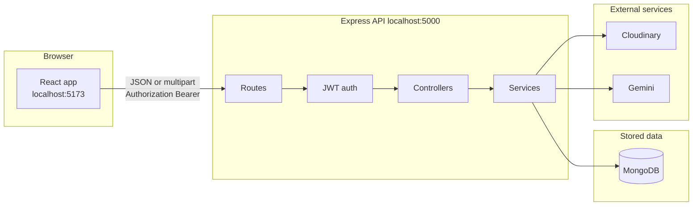
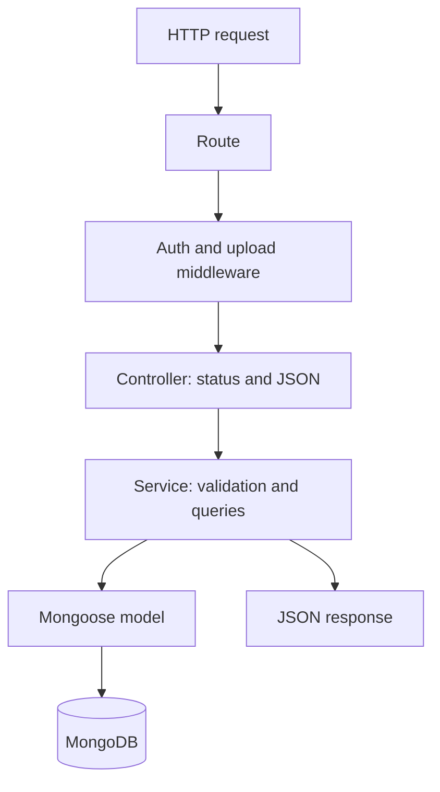
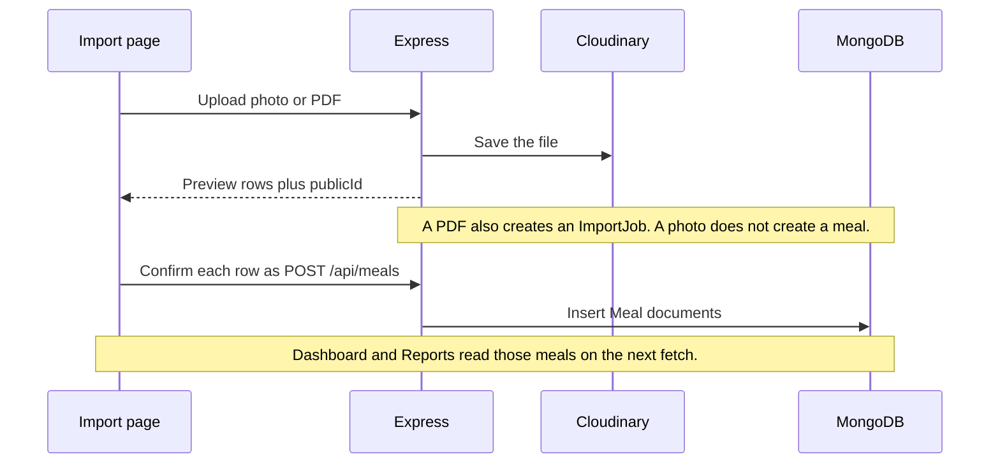

# Calorie Tracker

A personal calorie tracker. You log meals, set daily targets, and see how the day compares with those targets. You can also import a food-diary PDF, read a food photo, or ask the chat to log a meal.

The interface is a React app. The API is Express. Meals, goals, and chats live in MongoDB. Photos and PDFs are stored in Cloudinary. Photo reading and chat use Gemini.

## Architecture

The browser never talks to MongoDB, Cloudinary, or Gemini. Every screen calls the Express API. The API checks the signed-in user, then reads or writes that user's data.



A request moves in one direction through the backend:



Controllers do not contain nutrition math. Services do. Reports are calculated from meals and the user's goals when the page asks for them. There is no separate summary collection.

## Screens

The app is one page. After login, the sidebar switches the view. The first view is Dashboard.

| Screen | What it shows | API it uses |
| --- | --- | --- |
| Dashboard | Today's calories, macros, meals, micronutrients, and a 7-day calorie chart | `/api/reports/*`, `/api/meals` |
| Meals | Add, edit, filter, and delete meals | `/api/meals` |
| Goals | Daily calories, protein, carbs, fat, and a weight goal | `/api/goals` |
| Reports | A date range of the same totals | `/api/reports/*` |
| Import | Photo preview or PDF table preview, then confirm | `/api/extract/*`, `/api/imports`, `/api/meals` |
| Chat | A nutrition assistant that can log meals and read reports | `/api/chats` |

Login and register use `/api/auth`. The token is stored in `localStorage` and sent as `Authorization: Bearer <token>`.

## Data

Each document belongs to one user. List and report queries always filter by that user id.

| Collection | Purpose |
| --- | --- |
| User | Username, email, and a hashed password |
| UserGoals | One daily-target document per user |
| Meal | One food entry: macros, optional micronutrients, time, and source |
| ImportJob | A record of an uploaded PDF, not the meal rows |
| Chat / Message | Chat history for the assistant |

A meal's `source` is `manual`, `ai_photo`, `pdf_import`, or `chat`.

Micronutrients are iron (mg), calcium (mg), vitamin A (mcg RAE), vitamin C (mg), and vitamin D (mcg). A blank value is stored as `null` and means "not measured." A stored `0` means the amount is zero. Reports skip `null` values. If no meal in the range has a number for a nutrient, the total is `null` and the UI says "Not tracked."

Date filters use your timezone. The client sends `tz` with `from` and `to`. A date-only range covers that local calendar day.

## Two flows that do not save a meal immediately

Photo and PDF import preview first. The meal is written only when you confirm.



If you discard a photo before saving, the API deletes the Cloudinary file. It only deletes a file whose `publicId` starts with `calorie-tracker/<your user id>/`.

Chat can create, update, and delete meals through the same meal service. Gemini decides when to call those tools. The signed-in user comes from the token, not from the model.

## Project layout

```text
calorieTracker/
  frontend/                 React + Vite
    src/App.jsx             Shell, sidebar, and screen switch
    src/Dashboard.jsx       Daily snapshot
    src/Meals.jsx           Meal form and list
    src/Goals.jsx           Targets
    src/Reports.jsx         Range reports
    src/ImportFood.jsx      Photo and PDF preview
    src/Chat.jsx            Assistant
    src/api.js              fetch client and auth header
  backend/
    src/server.js           Express app and route mounting
    src/routes/             URL paths
    src/controllers/        HTTP in and out
    src/services/           Meals, reports, PDF, upload, chat, goals
    src/models/             Mongoose schemas
    src/middleware/         Auth, uploads, errors
    test/                   Nutrition and meal tests
```

The API details and endpoint table are in [backend/README.md](backend/README.md).

## Run it locally

You need Node.js, a local MongoDB, and the keys in `backend/.env.example` if you want photo, PDF storage, or chat.

Start MongoDB, then in two terminals:

```bash
cd backend
npm install
npm run dev
```

```bash
cd frontend
npm install
npm run dev
```

The API listens on `http://localhost:5000`. The app listens on `http://localhost:5173`. `GET /health` reports whether MongoDB is connected.

Copy `backend/.env.example` to `backend/.env` and set `JWT_SECRET`. Photo extract and chat also need `GEMINI_API_KEY`. Photo and PDF storage need the Cloudinary values. Do not commit `.env`.

Frontend production build:

```bash
cd frontend
npm run build
```

Backend tests:

```bash
cd backend
npm test
```

The integration test needs the same `MONGO_URI`. It creates temporary users and deletes them afterward.

## API map

All routes except `/health`, `POST /api/auth/register`, and `POST /api/auth/login` require the bearer token.

| Method | Path | Role |
| --- | --- | --- |
| POST | `/api/auth/register` | Create an account |
| POST | `/api/auth/login` | Return a token |
| GET | `/api/auth/me` | Current user |
| GET, PUT | `/api/goals` | Read or replace daily targets |
| POST, GET | `/api/meals` | Create a meal, or list with `from`, `to`, `tz`, `mealType` |
| GET, PATCH, DELETE | `/api/meals/:id` | One meal, owner only |
| GET | `/api/reports/weekly` | Calorie total per day |
| GET | `/api/reports/macros` | Macros by day or week |
| GET | `/api/reports/micros` | Micronutrient totals and coverage |
| GET | `/api/reports/goals-vs-actual` | Intake against saved daily targets |
| POST | `/api/extract/image` | Read a food photo. Does not save a meal |
| POST | `/api/extract/pdf` | Read PDF tables and store the file on an import job |
| POST | `/api/extract/discard` | Delete an unsaved upload |
| GET | `/api/imports` | Recent PDF uploads for this user |
| POST, GET | `/api/chats` | Create or list chats |
| GET, POST | `/api/chats/:id/messages` | Read history or send a message |
